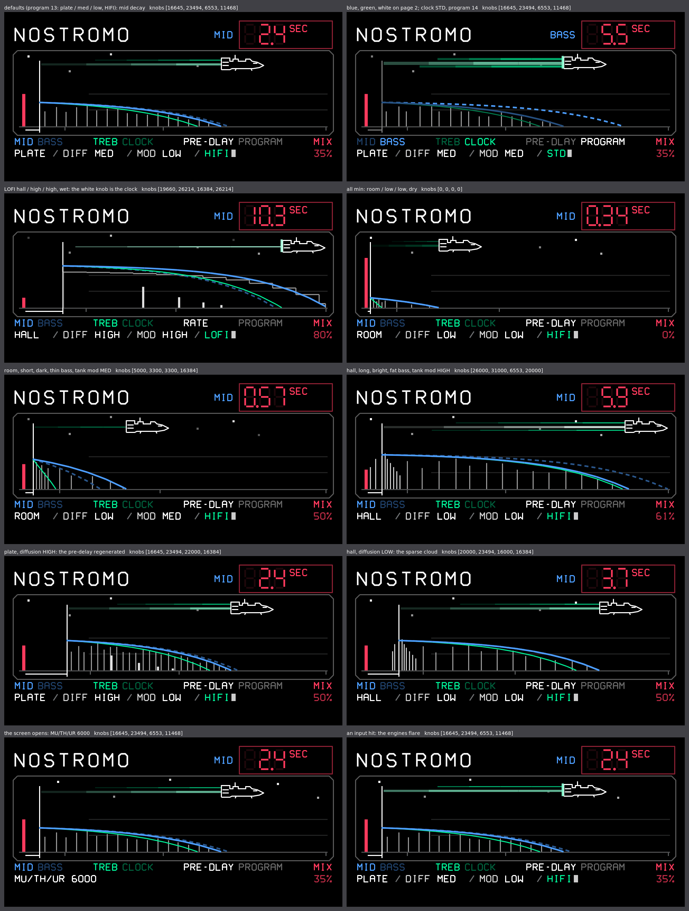

# nostromo — a reverb on Dattorro's plate tank, with the CXM 1978's controls (FX)

Jon Dattorro's plate, the design behind the Lexicon 224 lineage and the Synthstrom Deluge's "Digital" reverb, in
fixed point, with the six faders and four switches of the Chase Bliss CXM 1978, its CLOCK included. The screen draws
the reverb's impulse response under the 224's LED readout, as line art from the Nostromo's computers, with the ship
riding the tail.

## Knobs

| knob | page 1 | page 2 (press) |
|---|---|---|
| blue | **mid decay**: RT60 above 700 Hz, 0.34 / 0.55 / 0.8 … 10 s (room / plate / hall) | **bass**: RT60 below 700 Hz, its own time over the same range |
| green | **treble decay**: the loop's damping, 500 Hz … 16 kHz | **clock**: HIFI → STD → LOFI → HIFI …, a step every 2 detents |
| white | **pre-delay**: 0 … 500 ms (LOFI: the clock, 22 … 2.8 kHz) | **program** 1 … 27 |
| red | **mix**: dry … wet | — |

The readout shows the control turned or paged last, named in its knob's colour; when the screen opens, blue's current
page (mid decay or bass). Each knob's current page is bright in the label row. Mid decay and bass are separate times, both in seconds, as on the Lexicon 224 and the CXM 1978; treble is the
frequency the highs roll off above, so their decay follows the mid's. The clock knob shows the tank's clock in kHz. In LOFI
the readout follows the clock: the white knob is labelled RATE and shows it in kHz, as the CXM 1978's pre-delay slider sets
the sample rate in its LoFi mode, and mid decay and the treble cutoff show what the
clock makes of them.

## Screen

One page. The scope draws the reverb's impulse response on a log time axis (0 to 10 s):

- **mix**: the red dry hit against the height of the wet tail;
- **pre-delay**: the white bracket and gate where the tail starts;
- **mid decay, bass, treble**: the solid blue, dashed blue and green curves, each 60 dB down at its RT60;
- **diffusion**: the number of reflections; HIGH draws the attack's echoes through the regenerated pre-delay, a hall at
  LOW its sparse cloud around the gate; **tank mod** scatters the reflections; a room adds early ones;
- **clock**: STD draws the reflections in 12-bit steps, LOFI as a sample-and-hold staircase at its clock.

The Nostromo sits where the mid decay falls silent, its exhaust running back to the gate. The bass, against the mid,
sets the exhaust's volume (one to three streaks), the treble its heat (smouldering green to white-hot), the mix its
brightness; the engines flare when the input hits. The tank mod moves the ship, least to most: LOW drifts it,
MED bobs it, HIGH rocks it fastest and makes the flame shimmer. The stars follow: steady at LOW, a slow twinkle
at MED, a fast flicker at HIGH. HIFI moves smoothly, STD at half rate on a 2 px grid, LOFI in steps at its clock.
A type or clock change, which fades and clears the reverb, sends the ship to hyperspace and back.

The caption below spells out the program and types itself out when it changes. The screen opens with MU/TH/UR 6000.
A hall's mid decay turned to 10 s brings SPECIAL ORDER 937, and the mix turned to 0 CREW EXPENDABLE.

The scope's lines are worked out only when a setting changes and drawn from a list each frame; the labels are one
copy each, recoloured for their page.

## Programs

Program = type × diffusion × tank mod: 1 = room / low / low … 27 = hall / high / high. The default, 13, is
Dattorro's own plate (plate / medium / low), on the HIFI clock.

- **clock** (green, page 2), a rotary switch: every 2 detents the next clock, round and round. HIFI runs the reverb at 44.1 kHz. STD runs it at 22.05 kHz, darker and band-limited
  near 10 kHz like the 224's 20 kHz, with the 224's gain-stepped 12-bit converters on the wet. LOFI samples and holds
  at a clock the white knob sets, 22 kHz down to 2.8 kHz, with the same converters: as the clock drops, everything
  stretches (decay, and pre-delay from 186 ms to 1.5 s) and grits up. A change fades the reverb out and clears it.
- **type**: room, plate, hall scale every delay ×0.6, ×1, ×1.5; room adds seven early reflections. A change fades
  the reverb out and clears it.
- **diffusion**, after the CXM 1978: low leaves the attack unsmeared (a hall adds a sparse cloud of 8 soft taps
  around the pre-delay), medium softens it (Dattorro's own), high softens it most and regenerates the pre-delay
  through the diffusion at a fixed 0.5, a 64-sample block late: short pre-delays comb or thicken, long ones (LOFI)
  echo, each repeat more smeared.
- **tank mod**: low (a slow random wander), medium (deeper, chorus-like), high (about 6 Hz, a rotating-speaker
  shimmer).

## Notes

Mono, like every op1r FX (the master runs it on (L+R)/2). Memory: a 64 Ki-sample ring for the tank and 500 ms for
the pre-delay in the FX position's scratch buffer. STD and LOFI run the tank at half the rate or less, so they cost
less than HIFI. Built from Dattorro, "Effect Design, Part 1" (1997), with the Deluge's Digital model (Katherine
Whitlock, GPL-3.0) as the reference and the fixed-point helpers of `plugins/reverb` (Mutable Instruments Elements,
Émilie Gillet, MIT).
